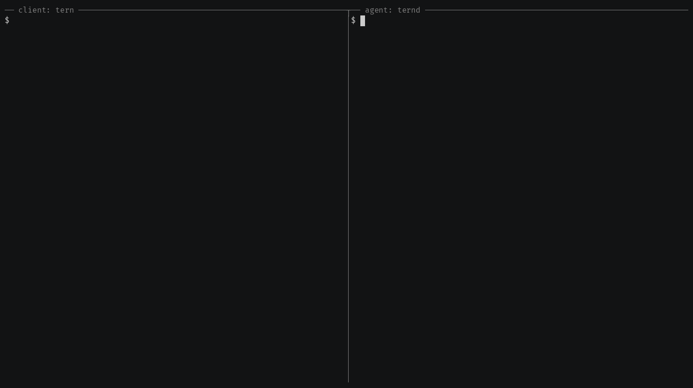
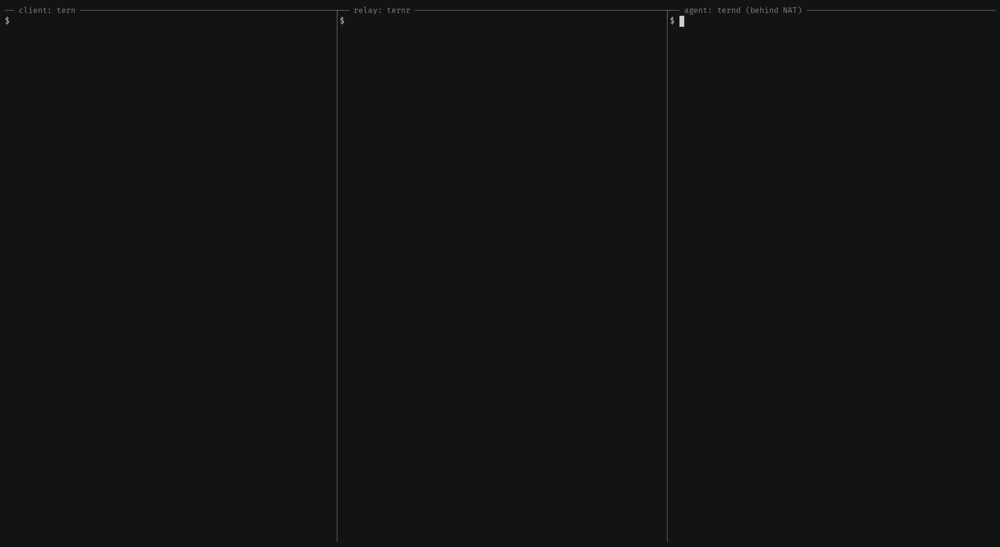

# Getting started

Each recording below is a real session with the v1.0.0 binaries on one
machine over loopback, recorded with asciinema.

On startup `ternd` logs its fingerprint (`agent fingerprint: ...`) and prints a
`tern connect` line to paste. When ternd minted the token itself, the line
carries `TERN_TOKEN=<token>`; otherwise it has a placeholder for the credential
you configured, `TERN_TOKEN=<your-token>` or `--key <your-key>`: replace it, or
drop it when `TERN_TOKEN` is already set. In relay mode the line also starts
with a `TERN_RELAY_TOKEN=<relay-token>` placeholder: the relay token is yours,
so ternd never prints it.

## 1. Direct: `tern` -> `ternd`

```bash
# agent: zero-config, listens on port 2222 on every IPv4 and IPv6 address,
# mints a token, prints its fingerprint
ternd

# client: connect by IP with the agent's fingerprint and token
TERN_TOKEN=<token> tern connect -a AGENT_IP:2222 -f <agent-fp>
```



`ternd` also prints a ready-to-paste `TERN_TOKEN=... tern connect --to
tern1:...` line that bundles the address and fingerprint. Its address is the
listen address, with a wildcard bind such as `0.0.0.0` shown as `127.0.0.1`, so
as printed it only works on the agent host; from another machine, connect by IP
as above or start `ternd -a <agent-ip>:2222`.

## 2. Through a relay: `tern` -> `ternr` <- `ternd`

The agent dials out to a public relay, so it needs no inbound port.

```bash
# relay, on a public host: note the fingerprint=<relay-fp> it logs
export TERN_RELAY_TOKEN="$(tern genkey)"
ternr --addr 0.0.0.0:7000

# agent behind NAT: dials out with the same relay token
TERN_RELAY_TOKEN=<relay-token> ternd --relay RELAY:7000 --relay-fingerprint <relay-fp> --id box1

# client: paste the line ternd printed, with the relay token filled in
TERN_RELAY_TOKEN=<relay-token> TERN_TOKEN=... tern connect --to tern1:...
```



The `tern1:` string holds no secret: the relay token comes from
`TERN_RELAY_TOKEN` or `--relay-token-file`, as the agent token does from
`TERN_TOKEN`. Either way the relay token is only proved to the relay, never
sent.

## 3. Combined relay + client: `rtern` <- `ternd`

When one person needs to reach one agent, `rtern` replaces the separate relay
and client with a single process: it waits, the agent dials in, and you land in
its shell.

```
 separate — agent and client meet at a public relay (ternr)

    behind NAT                    public                     anywhere
   ┌──────────┐   dial out    ┌──────────┐    connect    ┌──────────┐
   │  ternd   │ ─────────────▶│  ternr   │◀───────────── │   tern   │
   │  agent   │               │  relay   │               │  client  │
   └──────────┘               └──────────┘               └──────────┘
        ╰─────── end-to-end TLS + auth · relay sees only ciphertext ───────╯

 combined — one process is relay + client (rtern)

    behind NAT                            you, anywhere
   ┌──────────┐      dial out       ┌────────────────────┐
   │  ternd   │ ───────────────────▶│       rtern        │
   │  agent   │                     │   relay + client   │
   └──────────┘                     └────────────────────┘
        ╰──── end-to-end TLS + auth · drops you straight in the shell ────╯
```

```bash
# agent, once: share a token, create the cert and note the agent fingerprint
export TERN_TOKEN="$(tern genkey)"
ternd -a 127.0.0.1:2222            # stop it once "agent fingerprint: <agent-fp>" shows

# you: same token, then listen and wait for the agent
export TERN_TOKEN=<same-token>
rtern --fingerprint <agent-fp>

# agent: paste the ternd line rtern printed, without its TERN_TOKEN=<your-token>
# placeholder since TERN_TOKEN is already set
TERN_RELAY_TOKEN=<token-rtern-printed> ternd --relay <rtern-host>:7000 --relay-fingerprint <rtern-fp> --id box1
```


If no relay token is given (`TERN_RELAY_TOKEN`, `--relay-token-file` or
`--relay-token`), `rtern` generates one and puts it in the `ternd` line it
prints; fill in `<rtern-host>` when it listens on a wildcard address. The
agent keeps its fingerprint as long as its `.crt/.key` files are kept. Auth
is end-to-end: `rtern` pins the agent's TLS fingerprint and authenticates
with a key or token, same as `tern connect`. `rtern` is the only client of
the agents it catches: ignore the `tern connect` line that `ternd` prints
for a `ternr` relay.

## Keys instead of tokens

Every mode above also works with OpenSSH keys:

```bash
mkdir -p ~/.ssh && chmod 700 ~/.ssh
tern keygen --out ~/.ssh/id_tern   # or reuse an OpenSSH key such as ~/.ssh/id_ed25519
cp ~/.ssh/id_tern.pub agent_authorized_keys
ternd --authorized-keys agent_authorized_keys
tern connect --to tern1:... --key ~/.ssh/id_tern
```

`ternd` reads `authorized_keys` when it starts; restart it after changing
the file. It refuses one that someone else could change or put in its place,
and prints the fix; [`authorized_keys`](files.md#authorized_keys) has the full
rule.

## Insecure flags (testing only)

For local testing you can relax the transport security. `--insecure-dangerous`
turns off TLS and the client's verification of the agent and relay at once: the
client reaches the agent in plaintext with no fingerprint, and the agent still
requires the token or key, whose proof crosses in cleartext. Both ends must run
in plaintext (`ternd` prints the client line with `--insecure-skip-encryption`,
or `--insecure-dangerous` when it does not pin the relay). Each flag prints a
loud warning, and none may be used outside testing. See
[SECURITY.md](../SECURITY.md) for the full set of dangerous flags.


