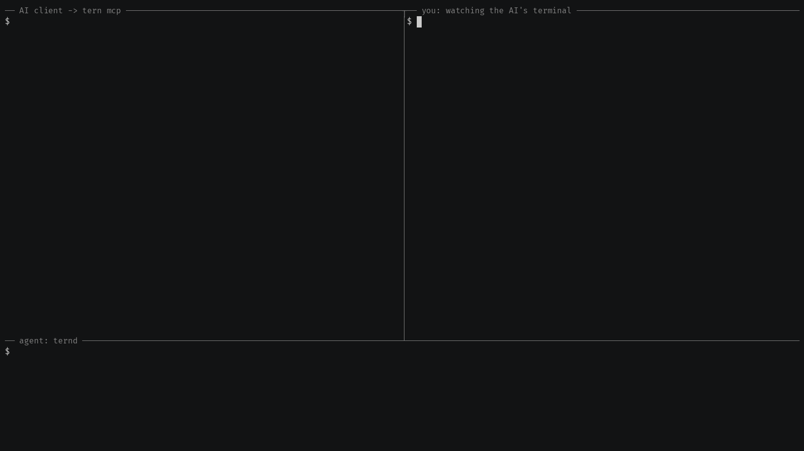

# `tern mcp`: AI agents over MCP

`tern mcp` is a [Model Context Protocol](https://modelcontextprotocol.io) server
that lets an AI client, such as Claude Code, Claude Desktop, Cursor or VS Code,
work on hosts that run `ternd`. It runs on your machine and talks to the client
over stdio. Every action the model asks for goes over the normal tern
transport (pinned TLS and authentication), is checked against a **policy
profile** before anything reaches the agent, and is written to an **audit
log**; to learn a host's OS, the first `agent_info`, or shell-mode `run` or
`job_start`, on it also runs a fixed `uname -srm`, and `cmd /c ver` where
that fails, as on Windows.



The client in the recording is a scripted MCP client, not part of this
repository, that makes the calls an AI agent makes; `tern mcp`, `ternd` and
`tern connect` are the real binaries.

## Quick start: read-only

With no config file, `tern mcp` serves one agent under the built-in
**readonly** profile: a short allowlist of inspection commands and reads of
configuration and logs, nothing that changes the host.

```bash
# Claude Code
claude mcp add tern -e TERN_TO=tern1:... -e TERN_TOKEN=... -- tern mcp
```

```json
{
  "mcpServers": {
    "tern": {
      "command": "tern",
      "args": ["mcp"],
      "env": { "TERN_TO": "tern1:...", "TERN_TOKEN": "..." }
    }
  }
}
```

The JSON form is for Claude Desktop, Cursor, VS Code and other clients that
start servers from a config file. Pass credentials through `env`, not `args`,
so they stay off the command line. Either way the client keeps them in plain
text in its own settings (Claude Code in `~/.claude.json`); to keep a token
in a file of its own, give `tern mcp` a `--token-file` instead, or use the
plugin, whose config file never holds a secret itself. Any
connection flag of `tern connect` works too (`--addr`/`--fingerprint`,
`--relay`/`--id`, `--key`). A path in a flag (`--key`, `--token-file`,
`--relay-token-file`, `--to-file`, `--config`, `--workspace`,
`--audit-log`, `--record-dir`) must be absolute, `~` or start with `~/`
(`~\` on Windows): an MCP client starts `tern mcp` in a directory of its
choosing, often the project it has open, so a relative one stops `tern mcp`
at startup. Paths in the config file are taken from the file's own
directory.

The readonly profile allows `uptime`, `date`, `hostname`, `id`, `whoami`,
`uname`, `df`, `free`, `ls` (up to two arguments), `echo`,
`cat /etc/os-release`, `systemctl is-active UNIT`, `systemctl is-failed UNIT`,
`systemctl show -p PROPS UNIT` (PROPS is the fixed list of state properties
`agent_info` shows; never a command line, the environment or credentials; UNIT
takes no glob), `journalctl -n N` and `journalctl -u NAME -n N` (the journal as
the system wrote it, which can show command lines, such as sudo's `COMMAND=`
entries and the description of a unit `systemd-run` started, which is its
command line; only known secret formats are redacted from them), and on Windows
`ipconfig`, `systeminfo` and `tasklist`; it may read `/var/log/**`, a few
`/proc` files, the Windows hosts file and logs, and the files under `/etc` that
every user may read: readable by others, in directories every user may enter (a
file only its owner or group may read, or one in a closed directory such as
systemd's 0700 credential store, commonly holds credentials). A log that links
into `/etc` reaches only what `/etc` shows, and one that links out of every
readable path reaches only a file every user may read. `agent_info` lists what
a profile allows, the read patterns that serve only files every user may read,
and the paths no profile may read or write.

## Claude Code plugin

The repository is also a Claude Code plugin marketplace. Its `ternimal`
plugin starts `tern mcp --config <file>` from your `PATH`, with the file
`~/.config/tern/mcp.json` unless you set another with
`/plugin configure ternimal@ternimal`, and adds two skills: `ternimal:ops`,
how Claude works with the tools, and `ternimal:setup`, how to install tern,
start `ternd` and write the config file.

```bash
claude plugin marketplace add ternimal/tern
claude plugin install ternimal@ternimal
```

The server is a local command, so the tools load in Claude Code and in Cowork
sessions that run on your computer; claude.ai chat loads only the skills.
The plugin's version is the release's.

## Config file

Several hosts, and profiles beyond readonly, come from a JSON file given with
`--config` (which then replaces the connection flags and `--profile`):

```json
{
  "targets": {
    "web1": { "to_env": "TERN_TO_WEB1", "token_file": "~/.config/tern/web1.token", "profile": "ops" },
    "db1":  { "addr": "10.0.0.5:2222", "fingerprint": "<agent-fingerprint>", "key": "~/.ssh/id_tern", "profile": "readonly" }
  },
  "profiles": {
    "ops": {
      "run": { "allow": [["systemctl", "restart", "nginx"], ["systemctl", "restart", "myapp"]], "shell": true },
      "pty": true,
      "read_paths": ["/srv/app/**"],
      "write_paths": ["/srv/app/**", "/tmp/**"],
      "confirm": ["run:shell", "write_file"],
      "limits": { "timeout_s": 600, "terminals": 2 }
    }
  },
  "default_target": "web1",
  "workspace": "~/tern-work",
  "audit_log": "~/.local/state/tern/mcp-audit.jsonl",
  "record_dir": "~/.local/state/tern/recordings",
  "persist_ptys": false
}
```

Secrets are never written in the file: a field that is not known, such as an
inline `"token"`, is an error. A target is reached by a `tern1:` string from
`to_env` or `to_file`, or by `addr` (direct) or `relay`, `relay_fingerprint`
and `id` (relay), with the agent's `fingerprint`. It authenticates with
`token_env`, `token_file` or `key`; a relay token comes from `relay_token_env`
or `relay_token_file`. A `token_file` or `relay_token_file`, and a `to_file`
whose string carries the relay token, must be private to you, as `--token-file`
must: one other local users could read or change stops `tern mcp` at startup
with the fix. A `key` is held to ssh's rule: one of yours that others could
open stops it too, while one another account owns (on Windows only SYSTEM or
Administrators), or, on Unix, a pipe of yours, is taken. The config file and
any `to_file` name the agents to trust: one another account owns (root, SYSTEM
and Administrators aside) or others could change is refused, and so is one
another account could have put in its place, through the directory it is in (on
Unix) or a symlink, as for `ternd`'s [`authorized_keys`](files.md#authorized_keys), though
others may read the config file and a `to_file` without the relay token. `~`
and a leading `~/` (`~\` on Windows) are the home directory, and other relative
paths are taken from the config file's directory: a relative `workspace` in
`~/.config/tern/mcp.json` would be in tern's own directory, so `tern mcp` stops
at startup and names the `~/` path likely meant. Without a known home directory
a `~` path stops `tern mcp` at startup, as does an empty `--config`. Each
target is checked when `tern mcp` starts: missing credentials, an empty
variable, or a fingerprint that is not 64 hex digits like the one `ternd`
prints (either case, colons allowed) stop it with an error, rather than letting
the client show a server that fails every call.

| top-level field | meaning |
|---|---|
| `targets` | named agents, each with the profile it runs under (`readonly` by default) |
| `profiles` | named profiles, see below |
| `default_target` | used when a call names no target; without it, a config with one target uses that one |
| `workspace` | local directory `upload` and `download` may use; without one those tools are off. Make it a directory of its own, such as `~/tern-work`, not a project or the home directory: what the tools there run code from at their next run is open-ended, and the rules below are best effort. The secret-path rules hold there too, so a key or login in it is never uploaded, and a download never creates a file at a never-writable place (`.zshenv`, `.ssh/`, `.config/autostart/`, a repository's `.git`, a build tool's hooks such as `.yarnrc` or `.mvn/`, an MCP client's or editor's settings such as `.claude/`, `.mcp.json`, `CLAUDE.md` or `.vscode/`), also through a link in the workspace. tern's own files are never uploaded nor created: its state and configuration directories, and this run's config file, audit log and recordings directory, and the token, key and `tern1:` files the config or the flags name. A local name a system may open as another is refused: a name a case-insensitive file system may take for `..`, and on Windows one that ends in a dot or a space, which Windows drops, an 8.3 short name such as `CLAUDE~1`, a `:` (a drive or a data stream) or a device name such as `NUL`. Where a link whose own name a rule matches (`~/.vim`, `~/.config/nvim`, `~/.local/bin`, `~/.kube`, on Windows also a junction such as `%APPDATA%\Code`) leads into the workspace, the rule holds there too: `tern mcp` looks once, at startup, at the names under the home directory that a rule names, under any case, and at the links in the workspace down to three directories, dot directories first, never onto another file system mounted there (on Linux, macOS and FreeBSD, as the system lists its mounts; on Windows a folder a volume is mounted on is a junction, which it does not read into) nor, on macOS, into the home folders the system asks the user about (Desktop, Documents, Downloads, iCloud Drive's and other apps' data) or the media folders. A link is followed wherever it leads, also out of the workspace and back, but not through more than 40 links; a link made later or deeper is not seen. The look has 3 seconds and stops short at them, after 20000 directories, 1000 symbolic links or 100000 steps following links, or when a directory does not answer, as on an unresponsive network mount: `tern mcp` then starts anyway, logs why, and refuses downloads and uploads until it starts again. A download creates nothing through a link that leads to no directory yet, and refuses a name that already exists when it is asked for, a link included. `upload` sends only regular files. A workspace that one of these rules matches as a whole (inside `~/.ssh`, a directory named for secrets or tokens, a `.claude` directory such as a Claude Code worktree, `~/.config/autostart`, `~/.config/tern`, `~/.local/state/tern` or the recordings directory, or a directory a link under a credential store's name leads to) is refused at startup; one that a link under a persistence point's name leads to as a whole, such as a scripts directory `~/.local/bin` links to, is kept for uploads, and every download into it is refused |
| `audit_log` | the audit log (default `$XDG_STATE_HOME/tern/mcp-audit.jsonl`, `~/.local/state/...`, or `%LocalAppData%\tern\...` on Windows) |
| `record_dir` | record each terminal the AI opens as an asciicast here |
| `persist_ptys` | leave terminals running when `tern mcp` exits and reattach them next time |

The same settings exist as flags: `--workspace`, `--audit-log`, `--record-dir`
and `--persist-ptys` (paths absolute or from `~`, as above), plus `--max-output`
(default 256 KiB per call, at most 16 MiB) and `--max-timeout` (default 5
minutes): the longest timeout `run`, `job_start` and `pty_run` accept, how
long a job runs unless it asks for less, and how long `write_file`, `upload`
and `download` may take; `run` and `pty_run` wait 30 seconds, or that
longest timeout where it is shorter, unless the call gives `timeout_s`. A
profile's `limits.output_bytes` and `limits.timeout_s` take the place of
these two for the targets that use it. The default audit log and
`--persist-ptys` need a state directory, an absolute `$XDG_STATE_HOME` or
else the home directory (`%LocalAppData%` on Windows): without one they stop
`tern mcp` at startup, and `--audit-log` or `audit_log` names another place
for the log. Without a config file, `--profile` can only be `readonly`.

## Profiles

A profile starts from the one it `extends` (readonly by default) and only adds
to it; it can never remove a rule of its parent. Its `limits` replace the
parent's, higher or lower. The built-in `readonly` profile cannot be
redefined.

| field | meaning |
|---|---|
| `run.allow` | extra argv patterns, such as `["systemctl", "restart", "nginx"]`. `*` matches any one argument, an option such as `--force` or a unit such as `reboot.target` included, so name the values you mean; a final `**` matches any number. The command is a bare name: never a path, a Windows drive-relative name such as `C:cmd`, a data stream or an 8.3 short name |
| `run.shell` | let `run` take a whole command line through `sh -c` or `cmd /c`. The policy cannot see inside a command line, so this trusts the model with anything the agent's user can do. On Windows the line reaches `cmd.exe` exactly as written (`cmd /d /s /c "LINE"`), so its quotes mean what they do at a `cmd` prompt |
| `run.allow_wrappers` | let a pattern with a slot (`*` or a final `**`) name a shell, interpreter or other program that runs arbitrary code (`bash`, `python3`, `env`, `xargs`, `find`, `git`, `ssh`, `curl`, `powershell` and the like, package managers, compilers and the like, programs that load a library or run a program they are given (`openssl`, `ssh-keygen`, `pkcs11-tool`, `p11tool`, `certtool`, every JDK tool such as `keytool` or `jcmd`, which take `-J-agentpath:` anywhere on the line, `redis-server`, `valkey-server`, `nginx`, `apache2` and `httpd`, `insmod`, `modprobe`, `gpg`, `gpg-agent`, `openvpn`, `stunnel`, `ldd`, which may run the program it lists, and `postgres` and `mysqld`, which preload libraries they are given), also as `bash.exe`, `python3.12`, `vim.basic` or `x86_64-linux-gnu-gcc`), which is otherwise refused. A pattern with no slot, such as `["openssl", "version"]` or `["nginx", "-t"]`, runs exactly that command line and may name one without it, but then takes no `stdin`, which such a program could run. The list is best effort: prefer patterns with fixed arguments |
| `run.confirm_unlisted` | a command outside the allowlist asks the user instead of failing; wrappers stay refused |
| `read_paths`, `write_paths` | path patterns for `read_file`/`download` and `write_file`/`upload`: absolute, or starting with `**`, with `*` for one segment and `**` for any number, and no `..`. Windows paths are written `/c:/...` and match without case. A path that a profile lists here is read whatever its mode where the file it leads to is listed too. A link from it to a place the profile does not list reaches what that place shows, but only a file every user may read where the link is under `/etc`, leads into `/etc` or leads out of every readable path |
| `confirm` | actions that need the user's approval every time: `run`, `run:shell`, `read_file`, `write_file`, `upload`, `download`, `pty_open`; `write_file` and `upload` confirm each other, as do `read_file` and `download` |
| `pty` | allow interactive terminals (the `pty_*` tools). Needs `run.shell`, since a terminal runs anything typed into it |
| `limits` | `timeout_s` (up to 86400), `output_bytes` (up to 16 MiB), `terminals` open at once per target (1 to 16, default 4; at most 16 on all targets together), `terminal_idle_s` before an unused terminal is closed (60 to 86400, default 600) |

Some paths are never readable or writable, whatever a profile says: credential
stores and private keys (`/etc/shadow` and password-hash backups such as
`/var/backups/shadow.bak`, `**/.ssh/**`, `**/.aws/**`, `**/*.pem`, `**/.env`,
OpenSSH keys under their default names (`id_rsa`, `id_ed25519`, ...) wherever
they are, and tern's own (`tern_id_*`, `id_tern*`), their `.pub` files too,
kubeconfigs, keytabs and Kerberos ticket caches, registry and package-manager
logins (Docker's, Podman's also under `/run/containers/0`, npm's, PyPI's,
Composer's, Maven's `settings.xml`, Gradle's, Yarn's, Poetry's, NuGet's, pip's,
Bundler's, Helm's, JFrog's, Cargo's, RubyGems', Terraform's, rclone's, and
those of gh, glab and hub), browser password stores, macOS password hashes and
keychains, desktop keyrings, Terraform state and variables, `*.env`,
`wp-config.php`, shell histories and `.viminfo`, the Erlang cookie, Tailscale
and etcd state, Ceph keyrings, `.fetchmailrc`, `.mylogin.cnf`, Maven's
`settings-security.xml`, Ansible vault password files, Windows SAM, DPAPI and
Wi-Fi stores, OpenSSH's `C:\ProgramData\ssh`, and similar), tern's own
configuration and state directories (`~/.config/tern`, `~/.local/state/tern`,
and their places on macOS and Windows), the settings of MCP clients and AI
coding tools, which can hold the token an MCP server is given (Claude Code's
`.claude/` and `~/.claude.json`, Claude Desktop's `claude_desktop_config.json`,
every `mcp.json` and `.mcp.json` and the other MCP server lists, Zed's
`settings.json` in a project's `.zed/` and the user's, Continue's `.continue/`,
OpenCode's `opencode.json` and `~/.config/opencode`, Goose's configuration,
Crush's `crush.json`, Qwen Code's `.qwen/`, `~/.config/anthropic`, `.codex/`
and `.gemini/`), files in directories named for secrets, credentials or tokens
(`/run/secrets`, Kubernetes' `/var/run/secrets`, systemd's runtime credentials
and credential stores `/etc/credstore`, `/run/credstore`, `/usr/lib/credstore`
and their `.encrypted` twins; a Kubernetes secret volume mounted under another
name is not caught), service credentials under `/etc` (sssd, nslcd, Kerberos
KDC stashes, Samba, Redis, Wi-Fi, OpenVPN logins, `.htpasswd`, mail relays,
SNMP, GitLab), and process memory, environment and links such as
`/proc/<pid>/root` under `/proc`. The list is best effort; keep `read_paths`
narrow.

Some paths are never writable, though a profile may let the model read them:
places where a file runs code or grants access later, such as `authorized_keys`
files anywhere, `.k5login`, `/etc/passwd`, `/etc/nsswitch.conf`, cron and
systemd directories, `/etc/profile.d`, `/etc/pam.d` and PAM modules,
`/etc/ssh`, shell startup files, `~/.bashrc.d` and bash completions,
`~/.local/bin` and the other directories on PATH (`/usr/local/bin`, `/usr/bin`,
`~/bin` under /home, /var/home, /root or /Users, `~/.cargo/bin`, and
Homebrew's, Go's, Linuxbrew's, npm's, Yarn's, Deno's, Bun's, Scoop's and .NET
tools' bin directories), Python and IPython startup files, editor and tmux
startup files, `.gdbinit`, `.psqlrc`, `.sqliterc`, `.irbrc`, i3, sway and
WezTerm configuration, a repository's `.git` (the directory, a `.git` file
naming one elsewhere, and everything in it, `commondir` included) and git
configuration, in bare repositories named `*.git` their config and hooks, a
file named `commondir` anywhere, a file named `HEAD` anywhere (with `objects/`
and `refs/` beside it git takes its directory for a bare repository and runs
what its config says), `.gitmodules`, `.husky` and `.githooks`, Mercurial's
`.hg`, Jujutsu's `.jj` and Sapling's `.sl`, the project files build tools run
code from at their next run (`.yarnrc` and `.yarn/`, `.pnpmfile.cjs`,
`bunfig.toml`, `.pre-commit-config.yaml`, the Gradle wrapper's
`gradle/wrapper/`, Maven's `.mvn/`, `.devcontainer`, JetBrains' `.idea/`,
`.bazeliskrc`, `.ripgreprc`), package-manager, boot, initramfs and network
hooks, D-Bus services and policy, acpid events, display-manager login scripts,
kubelet's static pods, Docker's `daemon.json`, Apache's and nginx's
configuration (`/etc/apache2`, `/etc/httpd`, `/etc/nginx`, and Homebrew's and
`/usr/local`'s), autostart, LaunchAgents and LaunchDaemons, what MCP clients,
AI coding tools and editors run or load (instruction files such as `CLAUDE.md`,
`AGENTS.md` and `AGENTS.override.md`, `GEMINI.md`, `.cursorrules`,
`.github/copilot-instructions.md` and `.github/instructions/`, `.goosehints`
and Zed's `.rules`, Claude Code's managed settings, the settings and hooks
Gemini CLI, Cursor and Codex take for every user (`/etc/gemini-cli`,
`/etc/cursor` and `/etc/codex`, and Gemini CLI's and Cursor's places on macOS
and Windows), Claude Desktop's data, `.cursor/`, `.vscode/` and its forks'
folders, the servers they install on the hosts they reach, the editors' user
data folders, `.windsurf/`, `.codeium/`, `.zed/` and Zed's folder, `.copilot/`,
`.amazonq/` and OpenCode's `.opencode/`), and on Windows the files directly in
`C:\Windows`, `System32` and the other system folders on PATH, PowerShell 7's
folder, Startup folders, scheduled tasks, PowerShell profiles and module
directories, WindowsApps, the per-user program folders
(`%LocalAppData%\Programs`, Claude's `%LocalAppData%\AnthropicClaude`, other
Squirrel installs' `app-<version>` folders and `Update.exe`, WinGet's links and
packages, Python's per-user `Scripts`), Office startup folders and Normal.dotm,
Outlook's VbaProject.OTM and the Store Windows Terminal's settings. The list is
best effort; keep `write_paths` narrow. Both lists match without case, also as
Linux casefold and APFS directories compare names, so `.ſsh`, `.ßh` or `.ssh`
with a zero-width joiner are caught.

The tools take absolute paths: `/unix/path`, or `C:\windows\path` on Windows,
where a `/` path may not contain `\`. Names a Windows agent would open under
another name are refused: trailing dots or spaces, 8.3 short names such as
`PROGRA~1`, and data streams. On macOS a path under `/System/Volumes/Data`
meets the never-readable and never-writable rules as its firmlinked name does
(allowed paths must be written as their patterns name them), and `/.vol`
paths are refused. Rules match the path as written, so a symlink under an
allowed directory reaches its target: a read, where the target is inside the
paths the profile may read (into or under `/etc`, only a file every user may
read, unless the profile names both paths itself) or is a file every user
may read; a write, wherever a link in the directories on its path leads,
while a link at the file's own name is replaced, not followed. Secret paths,
and for writes the never-writable places, are also checked on the target,
which the agent takes from the file it opened (for a write, from the
directory it opened), so a name swapped for a link in between cannot steer
the check. The agent reads nothing of a file before that check has passed,
so a refused read of `/proc/kmsg` takes no message from it; a file that
reports size 0, as under `/proc`, is read for what it holds then, at most
4 MiB and 5 seconds. An agent that cannot tell (a Unix other than Linux and
macOS, or Linux without `/proc`) reports the path as unresolved, and the
file tools refuse. A Windows agent reports every file as readable by every
user, so there the rules about files every user may read let through any
file the secret-path rules do not refuse. A hard link is not caught: it is
the same file under a second name, so do not let the model read a tree where
others can link to secret files.

## Tools

| tool | what it does |
|---|---|
| `list_targets` | the hosts this server reaches, with each one's profile and what it allows |
| `agent_info` | a host's OS, transport, profile, allowed commands and paths, which actions ask for approval, and whether it can be reached |
| `list_sessions` | the agent's live tern sessions |
| `run` | run one command and return its exit code and merged output |
| `job_start`, `job_poll`, `job_cancel`, `job_list` | run a command in the background and read its output by offset; cancelling kills the command with its process group, and on Linux every process still in its session or descended from it (on Windows, everything in its job object); a process that daemonized, starting a session of its own whose parent then ended, is not reached |
| `read_file` | read a file as text, paged by offset (`download` copies the exact bytes) |
| `write_file` | create or replace a file of up to 1 MiB, atomically through a temporary file |
| `upload`, `download` | copy files of up to 64 MiB between the agent and the workspace; a download never overwrites a file that exists when it is asked for. A file whose first 16 KiB hold a private key's first line (PEM, OpenSSH, armored PGP, PuTTY, age) at the start of a line, after spaces or tabs at most, is refused either way, whatever its name; UTF-16 text is read as text only when it starts with a byte-order mark. A key in another form, such as DER, an archive, an SSH2 file or a cloud service-account JSON, or one whose line starts after a carriage return alone, is not caught |
| `pty_open`, `pty_run`, `pty_send`, `pty_read`, `pty_resize`, `pty_list`, `pty_close` | interactive terminals, see below |

A tool that no target's profile can use is not offered: with only readonly
targets, the client sees no `job_*`, `write_file`, `upload` or `pty_*` tools:
background jobs come with a profile that adds `run.allow`, `run.shell`,
`run.allow_wrappers` or `run.confirm_unlisted`, and `upload` and `download`
also need a workspace. A workspace alone therefore lets the AI download files
from a readonly target too, within the paths that profile may read.

Command output and file contents are untrusted data from the remote host, and
the tool descriptions tell the model so. Text results carry no escape
sequences and no invisible characters, such as zero-width or bidirectional
controls, Unicode tag characters and variation selectors, so the model reads
what you would see. Where an escape sequence hides text, the text says
`[text hidden in a terminal escape sequence]`, because a shell that runs the
same bytes reads what a terminal would not show: in a file (`read_file`),
wherever a string sequence (a terminal title, a hyperlink target, a DCS or
APC string) hides anything; in command and terminal output (`run`,
`job_poll`, `pty_read`, `pty_run` and recordings), where one hides a line
break or more than 256 bytes, or shares its line with other text (up to the
next line feed; output that ends first, or a line that goes on 1 KiB past
the string, counts as text), so a short title on a line of its own passes
silently; and in both, where a control sequence is not one programs write
(parameters after intermediate bytes, more than two intermediates or one
other than space and `! " # $ ' * + ,`, a private marker after the first
byte, more than 64 parameter and intermediate bytes, or no final byte), or
an escape holds more than two intermediates, and where a control sequence or
an escape has a control character carried out inside it (a line feed there
starts a new command line for a shell while the sequence hides it).
Sequences with nothing shown between them get one note. In terminal text the
note starts the line that held the hidden text. The note goes in after
redaction, so it never splits a secret. Notes count toward a result's size,
so they cannot make it much longer than the output it covers: with its
notes, a `read_file` page is at most as long as its byte limit, a `job_poll`
page as the bytes it covers and `run` output as the output cap, or 64 KiB
where that is more. One that would run past that ends early, at the
sequence that would add the next note: `next_offset` continues from there,
and `run` sets `truncated`. Terminal text and recordings count notes toward
their own bound, four times the output plus a screenful, and say where they
were cut. A control sequence of the usual shape, such as a color or a
cursor move, and an escape that hides at most three characters, as a
charset change does, are not noted, though what they hide can still change
how a shell reads the line: a control sequence can hide up to 64 bytes of
parameters, such as `;` or `>`, up to two intermediates, such as `$` or `!`,
and a final byte, such as `|`.

Terminal text (`pty_read` text, `pty_run`, recordings) is a rendering of the
screen: what a carriage return, a backspace or an erase sequence overwrote
is not in it, and is not noted, since progress bars and line editors
overwrite all the time. A script printed in a terminal can so show other
lines than a shell runs from it: review a file with `read_file`, or a
command's output with `run` or `job_poll`, which keep every line.

Raw terminal output that holds escape sequences or invisible characters, or
any control character but tab, CR and LF, comes back base64, and raw output
whose text holds a secret comes back as that text, redacted. A file that
starts with a UTF-16 byte-order mark comes back as its text, every page of
it (encoding `text`); any secret its bytes show read as ASCII, as in a log
another tool appended to, or read as UTF-16 a byte off its code units or in
the other byte order, as after an odd number of appended bytes, is first
overwritten with asterisk bytes, which that text shows as other characters
(such as `⨪`). Another page that is not UTF-8 comes back base64, redacted,
or, when its Latin-1 text shows a secret the bytes hide (colors splitting a
key, say), as that text, redacted. A secret that bytes show read as UTF-16,
as a UTF-16 file without a byte-order mark does, is replaced by asterisks in
whatever form the page comes back.

Known secrets (private keys, PEM and PGP, and the rest of one whose start a
read does not hold; AWS, Google Cloud (`ya29.c.` tokens too), Azure storage and
SAS, DigitalOcean, GitHub, GitLab (runner and deploy tokens too), Slack
(app-level and refresh tokens too), Stripe (webhook secrets too), Hugging Face,
npm, PyPI, OpenAI and Anthropic tokens, Azure storage keys in the JSON
`az storage account keys list` prints, JWTs, age keys; credentials in URLs
whatever the host, passwords with `@` or `/` included, a token as a URL's user
name (Azure DevOps), and `Authorization:` and `Proxy-Authorization:`
credentials, whatever the scheme (all of a scheme's parameters, as Digest's),
on the name's line or on the line after it, indented or as a YAML list item, as
YAML and a folded HTTP header write them, and a quoted value of a quoted name,
as JSON writes it; kubeconfig keys; `PASSWORD=`, `"password": "..."`,
`'password': '...'` and `password => '...'` pairs, a value of several unquoted
words on a line its name starts (`password: correct horse battery staple`, as
env dumps, INI, `.properties` and `.env` files, YAML and cmd's `set` write it),
up to a comment (`#`, and after `=` also `;`, `//` or `/*`) or a `\` that
continues the line, YAML values on the line after their key, PHP `define()`,
.NET appSettings, XML elements such as `<password>`; names that hold a secret
word such as `SECRET_KEY`, `DB_PASSWORD_FILE`, `dbPassword`, and `*_PWD`,
`*_PASS`, `APP_KEY`; passwords given to `mysql -p` (the first and the last of a
command), `sshpass -p`, `curl -u`, `redis-cli -a`, the OpenLDAP tools' `-w`
(and the `-y` file), `docker login -p`, `sqlcmd`/`bcp`/`osql -P`, the MongoDB
tools' `-p`, OpenSSL `pass:` arguments and Samba `-U user%password`, keytool's
and jarsigner's `-storepass`/`-keypass` (and `keytool -new`), PuTTY's `-pw`,
`ipmitool -P`, 7-Zip's `-p`, `zip`/`unzip -P`, FreeRDP's `/p:`, `nmcli`'s
password and secret properties, `aws configure set` of a secret key or session
token, the Oracle tools' `user/password@db`, PsExec's and CrackMapExec's `-p`,
`htpasswd -b`, `net use \\server\share password`; the value of any command-line
option whose name says it is secret, such as `--relay-token`, `--db-password`
or `--client-secret`; Docker and npm registry auth) are replaced with typed
`[REDACTED ...]` markers in results and in the audit log, base64 results
included. An argument vector, in the audit log and `job_list`, is redacted as
the command line it makes too, so an option and its value given as separate
arguments are found, and the command line a refusal's reason quotes for a
command the allowlist does not hold is redacted as such a vector. A
`NAME=value` value is replaced whole: one that a known token only begins, one
with quotes after its first character, or one with a quote it never closes. A
value that starts as a reference or an expression does (`$VAR`, `$(...)`,
`${{ secrets.X }}`, a TOML `{` table, and in YAML a reference tag such as
`!secret` or `!Ref`, a `*alias` or a `[` list) is taken as its first word only,
a YAML value after a tag or an anchor (`!unsafe 'p{{w'`, `!!str 0123`,
`&pw value`) is taken after it, and an nsswitch.conf `passwd:` line, which
names lookup services, is left as it is. A read that pages through output or a
file is redacted together with 8 KiB of text on each side of it, taken from up
to 64 KiB of output, so escape sequences between a secret's halves do not keep
them apart, and a secret that a page starts or ends inside, such as a private
key, does not show in part. A page never starts or ends inside an escape
sequence or a character: one asked to start inside one starts after it
(`read_file` reports where, in `offset`), and one too small to hold a sequence
it starts with holds all of it, up to about 64 KiB past its byte limit, or, in
`job_poll` while the sequence is still arriving, holds it back, waiting out
`wait_ms` for more, and returns nothing new until it or the job ends; a run of
sequences that ESCs chain together and goes on longer is held as far as the
read goes, so pages read one after another from `next_offset` never start
inside one. The 64 KiB a page looks back at to learn this, as far as a sequence
may reach, is read as text up to its first ESC, CAN or SUB when it does not
start the output, so a sequence whose start it cannot see never makes a page
skip text (but a page asked to start inside a sequence that a C1 control began,
with no ESC, CAN or SUB in the 64 KiB before the page, reads its rest as text
too, where another C1 control can begin a sequence that hides what follows);
since that text may be the hidden rest of such a sequence, where it comes
within 8 KiB of the text of a `read_file` page or a `job_poll`, the page is
also redacted as if nothing came before that ESC, CAN or SUB, so the text
cannot join a secret the page starts with. A page of a UTF-16 file starts on a
whole character, but may start inside an escape sequence, whose rest then shows
nothing. `run` output cut at the cap is redacted with what followed the cut.
Once a job's or terminal's buffer has dropped older output, a read that would
start in the line the drop cut into, or in the blank or indented lines that go
on with it (a YAML value on the next line, the arguments of a call that spans
lines), starts after them, or 8 KiB in when they run longer, and `dropped`
counts what was skipped. A recording too long to serve whole is redacted first,
and only then is its start left out. Redaction is a safety net, not a
guarantee.

`run`, `job_start`, `write_file`, `upload`, `download`, `pty_send` and `pty_run`
take an optional `idempotency_key`: a call resent with the same key and
arguments, as a client may do after a dropped response, returns the first
result instead of acting twice.

## Confirmation

An action in a profile's `confirm` list, or an unlisted command under
`confirm_unlisted`, is shown to **you** before it runs. `tern mcp` asks through
MCP elicitation: the client shows a form with the target, the exact command
line or path (escaped, never cut short; an action too long to show whole is
refused instead), and a preview of any standard input or file content (the
first 800 bytes or 20 lines, saying when it shows only part; content that is
not UTF-8 is shown as text with each other byte as `\xNN`, marked binary, with
its SHA-256), and you tick **Approve** or decline. Only then does the call run.
The approval is bound to that exact action and used once, so it cannot be
replayed or moved to another command. An upload shows the file's content and is
bound to it: a file changed after you approved it is refused, and a new call
asks again. Typing into a terminal needs approval exactly when shell commands
do.

A client that cannot show forms gets a clear refusal rather than a prompt
nobody sees. This works with clients on MCP 2026-07-28 and on 2025-11-25.

## Terminals

With `pty: true`, the AI can open shells that persist between calls: the
working directory, environment and running programs carry over, as they do for
a person.

- `pty_open` starts a shell in a new tern session on the agent, named `mcp-`
  and random letters and digits. The model never chooses the name, so it
  cannot attach to a session it did not open.
- `pty_run` types a command line and Enter, waits until the shell shows its
  prompt again, and returns what the command printed, without the echoed
  command line and the prompt. Of a prompt that takes several lines, only the
  last is recognized and removed; the lines above it stay in the output, so a
  one-line prompt works best. A program left waiting for input, such as a
  question or a password prompt, ends the wait with `waiting_for_input`.
  The command keeps running after a timeout; read on with `pty_read`.
- `pty_send` types text and named keys (`Enter`, `Tab`, `Esc`, arrows, `C-c`,
  `M-x`, `F1` to `F12` and so on) for interactive programs. As with ssh,
  keystrokes sent just as the connection drops can be lost; `pty_read` shows
  whether they arrived.
- `pty_read` reads output from a byte offset, as text (escape sequences
  removed, line edits applied, as a person would read it, so what a line
  edit overwrote is not in it) or as raw bytes. It can wait for the prompt,
  for quiet output, or for a regular expression. A pattern that compiles to
  more than 1000 instructions is refused, and a match is only sure to be
  found if it is at most 4 KiB long. A prompt that sets the
  window title, as Ubuntu's default bash does when `ternd`'s own `TERM` names
  an xterm, shares its line with the prompt, so `pty_read` text and
  recordings show the hidden-text note at the start of each prompt line, and
  a line with hyperlinks shows one note. `pty_run` drops the prompt line, and
  its note when the prompt itself hides text, as a prompt that sets the title
  does; a note about text the command's output hid on that line, which it
  shares with the prompt when the output did not end in a line break, stays.
  The prompt is told by the bytes it showed before the command: the same
  bytes, or, for a prompt that changed since, as one showing the working
  directory or the last command's status does, as many of the line's last
  string sequences (titles and the like) as the one before had, and what
  follows them. With no prompt known before, one that held no string
  sequence, or a line with fewer of them, the note stays.

**Watching and taking over.** `pty_open` returns a `watch` command, which
carries no credentials:

```bash
tern connect --addr HOST:2222 --fingerprint <fp> --session mcp-ab2cd3ef4gh5 --read-only
```

Each argument is quoted for a POSIX shell where it needs to be, so a value
from a `tern1:` string runs nothing when you paste the line. Run it with your
own credentials, such as `TERN_TOKEN` or `--key`, to see the AI's terminal
live, and press Ctrl-C to leave. `take_over` is the same with
`--read-only=false`, to type in it too. If you are writing in the session when
the AI's connection comes back after a drop, the AI comes back read-only,
however soon it reconnects: it can still read the terminal, but cannot type
in it.

A terminal survives a dropped connection: `tern mcp` reconnects and the output
continues without repeating what was already read; if the agent had already
dropped some output from while the connection was down, the output says how
much was lost. Terminals close when `tern mcp` exits, when the AI calls
`pty_close`, or after `terminal_idle_s` unused; a terminal a call is waiting
on is never idle. On a Windows agent, closing a terminal also ends what its
shell started; on Linux and macOS a program the shell left running in the
background keeps running. An ended terminal stays readable for 10 minutes,
but one closed with `pty_close` is gone at once; a target keeps only as many
ended terminals as it may have open, the most recent ones.
With `--persist-ptys` they are instead left running when `tern mcp` exits, and
the next `tern mcp` with the same targets reattaches them under the same
`pty_id`s; the agent ends a session nobody reattaches within its
`--session-idle` time. Which terminals to reattach is kept in
`mcp-ptys-<hash>.json` in the state directory (`$XDG_STATE_HOME/tern` or
`~/.local/state/tern`, on Windows `%LocalAppData%\tern`), one file per set of
targets. Only terminals in sessions named as `tern mcp` names its own are
reattached, and a download never writes to that directory.

With `--record-dir`, each terminal is recorded as an asciicast (play it with
`asciinema play`), and the recording is also served as the MCP resource
`tern://{target}/recording/{pty_id}`, as the text a person reads (escape
sequences removed, line edits applied, so what they overwrote is not in it)
and redacted. A reattached terminal starts a new recording file. If the
directory cannot be created, `tern mcp` warns and records nothing.

## Audit log

Every tool call gets at least one JSON line: the time, the client and protocol
version, the tool, the target, the arguments (redacted; an argument vector, a
rejected call's too, also as the command line it makes; standard input only by
size, file content by size and SHA-256, and the text `pty_send` types only by
size), and the outcome: `start` and `end` around an action, cancelling a job
and closing or resizing a terminal included (or `error` when it failed), `info`
for the listing tools and for reading a job's or terminal's output or a
recording (`agent_info` and `list_sessions`, which reach the agent, log `start`
first; `read_file` and `download` log `start` and `end`), `denied` with the
reason, `rejected` for a call that does not match the tool's input schema
(other bad arguments are `denied` with the reason), `confirm_requested` when
you are asked, and `replayed` for an idempotent resend; an action you approved
carries `"confirmed": true`. Output itself is not logged, only its size. If the
log cannot be written, `tern mcp` refuses to act: an action is refused before
it starts (nothing reaches the agent, a shell-mode command's OS probe included,
and a download makes no directory), and a listing or reading tool returns an
error instead of its result. What already runs goes on, and what stops it still
happens: a terminal left idle is closed and a job reaching its timeout is
killed, each with a warning on stderr, and when `tern mcp` exits it closes its
terminals (or leaves them running with `--persist-ptys`) and cancels its jobs.
The file is created owner-only. Characters a person would not see or a terminal
would act on, such as bidirectional and C1 controls, are written as `\u`
escapes.

## Windows

Windows agents work, terminals included. The text rendering understands the
cursor jumps Windows' ConPTY uses instead of line breaks, `pty_run` recognizes
`cmd.exe` prompts, and `C-c` interrupts a running command. Full-screen programs
are drawn with cursor addressing, which text cannot show; read such a terminal
with `pty_read` in raw format. The readonly profile's allowlist is aimed at
Unix commands plus a few Windows ones.

A command whose program is a batch file (`.bat` or `.cmd`, as many npm and
Python tools are on Windows) runs under `cmd.exe`, which reads `&`, `|`, `%`,
quotes and the like in its arguments as syntax. So that an argv allowlist still
means one command, the agent refuses such characters in a batch file's program
name and arguments, however its path is written; use shell mode, where the
line reaches `cmd.exe` exactly as written, where you need them.

## Compatibility

Run the same release of `tern`, `ternd`, `ternr` and `rtern`: different
releases are not promised to work with each other, so a relay, the agents
registering with it and the clients going through it, and `tern mcp` and the
agents it reaches, must all be from the same release.

## Security

`tern mcp` enforces its policy on your machine, with your credentials, so it
protects you from a model doing things you did not intend; it is not a
boundary against someone who controls your machine or your MCP client. See
[SECURITY.md](../SECURITY.md) for the threat model, and keep the agent's own
privileges as low as the work allows.

`tern mcp` refuses the `--insecure-*` connection flags, since a man in the
middle could then inject instructions into what the model reads; pass
`--allow-insecure-transport` only for a test setup. A config file cannot use
them at all.
